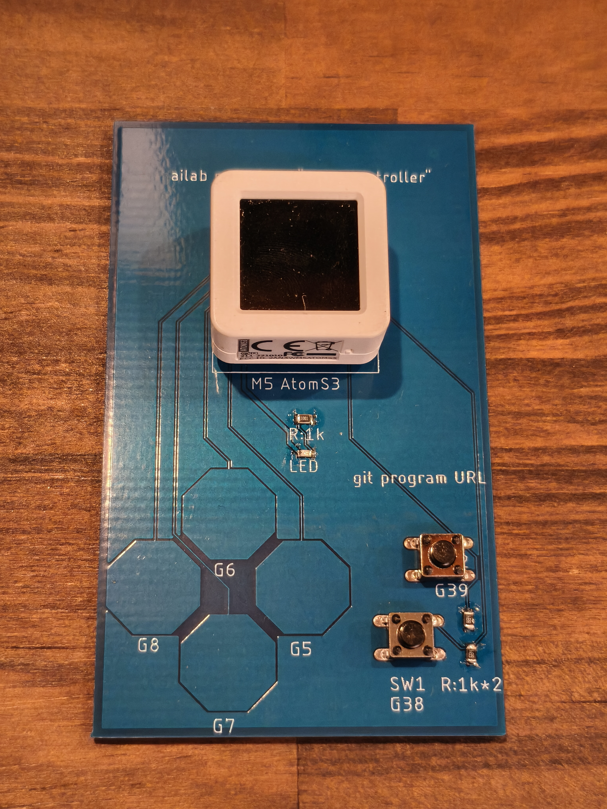

# いらいら棒ゲーム(PCB ゲームコントローラ基板用)

M5Stack **AtomS3** を取り付けて遊ぶ、ゲームコントローラ基板用の「いらいら棒」ゲームです。
壁に当たらないようにプレイヤーを操作して、ゴールを目指します。

## 必要なもの

- ゲームコントローラ基板(配布品)
- M5Stack AtomS3(**画面付きモデル**。AtomS3 Lite では動きません)
- USB Type-C ケーブル(データ通信対応のもの)
- PC(Windows / macOS / Linux)

## 書き込み手順

### 1. 開発環境を用意する
1. [Visual Studio Code](https://code.visualstudio.com/) をインストール
2. VS Code の拡張機能から **PlatformIO IDE** をインストール

### 2. プログラムをダウンロードする
このページ上部の緑の **Code** ボタン → **Download ZIP** で保存し、展開します。
(Git を使える人は `git clone https://github.com/satoshi-fujita/PCB_gaming_controller.git`)
### 3. 基板の組み立て(はんだ付け)

> [!WARNING]
> **スイッチ用抵抗の値を変更しています。**
> 基板のシルク印刷は **1kΩ** となっていますが、これは誤りです。**680kΩ** の抵抗を取り付けてください。

### 部品表

| 部品 | 記号 | 値・型番 | 数量 | 備考 |
|---|---|---|---|---|
| 抵抗 | R | **1kΩ** | 1 | LED用　LEDの上の抵抗 |
| 抵抗 | R | **680kΩ** | 2 | SW用　シルクの「1kΩ」は誤り |
| LED | LED | OSR50603C1E | 1 | 1608LED 色は何色でも可 |
| タクトスイッチ | SW1〜SW2 | TVDP01-060CB | 2 | |
| ピンソケット |  | 4pin |  | AtomS3 取り付け用 |
| ピンソケット |  | 5pin |  | AtomS3 取り付け用 |
| マイコン |  | AtomS3 |  | AtomS3Rでも可 |

### 取り付け順序

背の低い部品から順に付けると、基板が安定して作業しやすくなります。

1. **抵抗**:向き(極性)はありません。680kΩ であることを確認してから差し込みます
   (色帯:青・灰・黄・金)
2. **タクトスイッチ**:穴に合わせて差し込み、基板に浮きがないよう押さえてはんだ付け
3. **ピンソケット**:AtomS3 を差し込んだ状態ではんだ付けすると、まっすぐ取り付けられます。
   その場合は AtomS3 に熱が伝わりすぎないよう、手早く作業してください
4. **LED**:LEDの緑色の部分（カソード）が、シルクのLEDという文字のD（右）に来るように、はんだづけしてください。

### はんだ付け後のチェック

- 隣のパッドとはんだがつながっていない(ブリッジしていない)か
- はんだが富士山型に、パッド全体になじんでいるか

### 作業時の注意

- はんだ付け中に AtomS3 を USB 接続しないでください
- 作業中は換気をしてください
- はんだごてのこて先は非常に高温です。使用後はこて台に置き、電源を切ってください

### 4. 書き込む
1. VS Code で **ファイル → フォルダーを開く** から、展開したフォルダを開く
2. AtomS3 を USB ケーブルで PC に接続
3. 画面下のステータスバーの **→(Upload)** をクリック
4. 「SUCCESS」と表示されたら完了。AtomS3 を基板に取り付けて遊べます

初回はライブラリのダウンロードで数分かかります。

## 遊び方
スタート画面

| ボタン | 動作 |
|---|---|
| G6 | 上へ移動 |
| G7 | 下へ移動 |
| SW2 | スタート / 難易度選択 |

- 壁に当たるとゲームオーバー
- 難易度は 3段階
- 明確なゴールはありません、生存時間を競います

## うまくいかないとき

- **書き込みが失敗する / ポートが見つからない**
  AtomS3 のリセットボタンを約2秒長押しし、内部の緑色LEDが点灯したら(書き込みモード)、もう一度 Upload してください。
- **PC が AtomS3 を認識しない**
  充電専用ケーブルの可能性があります。別のケーブルで試してください。
- **ボタンが反応しない**
  AtomS3 が基板に奥まで差し込まれているか確認してください。

## 詳細情報

- ピン割り当て:○○
- 設計資料:[docs/](docs/)

## ライセンス
