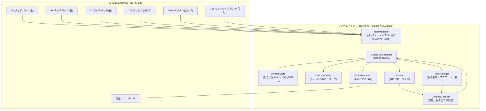
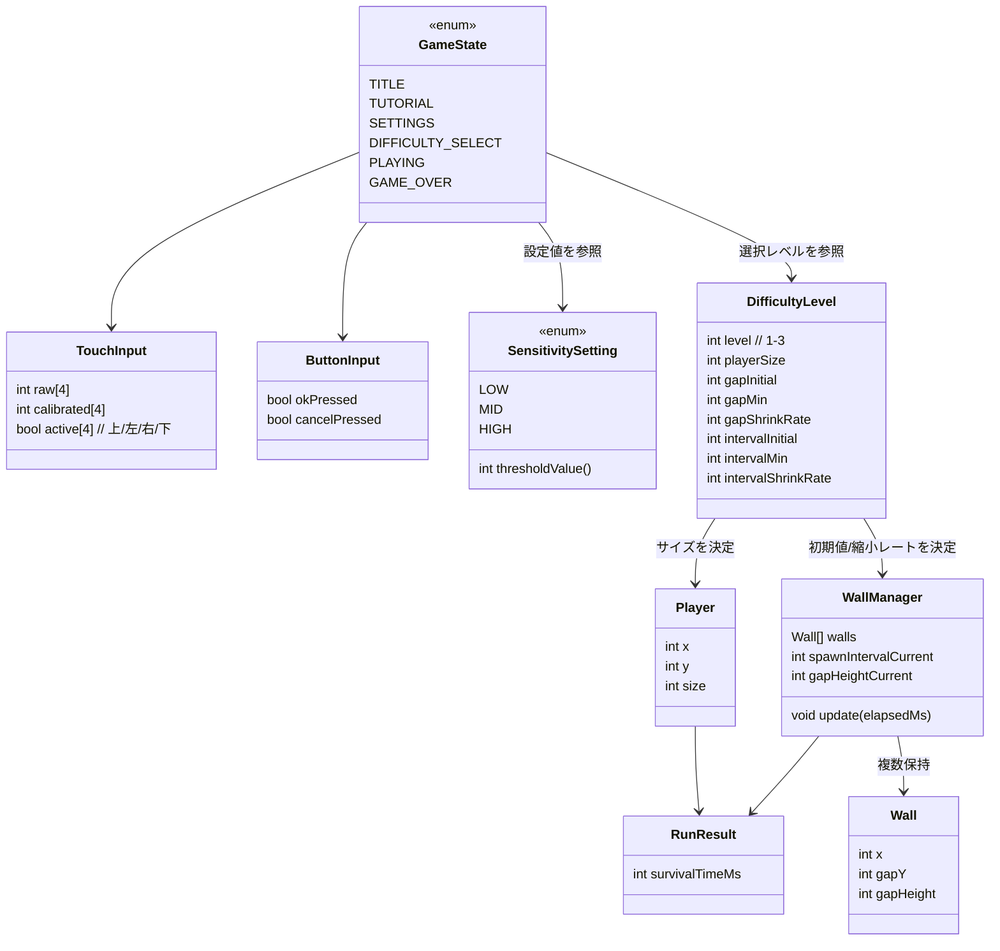
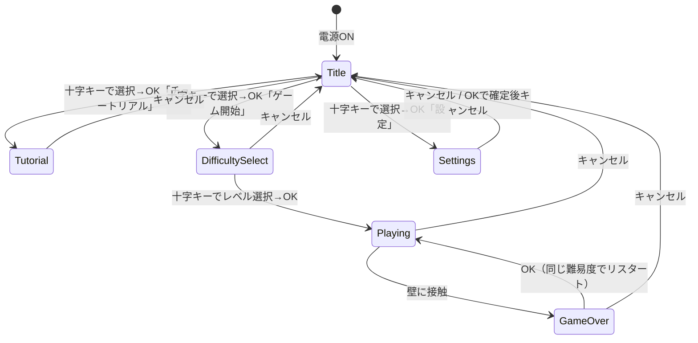

# 機能設計書（functional-design.md）

本ドキュメントは`docs/product-requirements.md`（承認済み）で定義した要求を、どう実現するかを設計する。

## 1. システム構成図



- 既存の`main.cpp`（タッチ値読み取り＋`GUI`描画の動作確認プログラム）を土台に、`InputManager`と`GameStateMachine`を新設して拡張する。
- 既存`GUI`クラスは「画面ごとの描画」を担う`Renderer`として責務を継続する（クラス名は既存のまま`GUI`を拡張する想定）。

## 2. データモデル定義

RDB等は用いないため、ER図の代わりに実行時に保持するデータ構造（struct/enum）の関係を示す。



- `SensitivitySetting`（弱・中・強）は`TouchInput`のキャリブレーション値からの変化量を「入力あり」と判定する際のしきい値を決定する。
- `DifficultyLevel`（1〜5）は`Player.size`と`WallManager`の開口・出現間隔の初期値／縮小レートを決定する。
- `RunResult`（生存時間）はゲームオーバー時に確定し、ゲームオーバー画面の表示に使う（永続保存はスコープ外）。

## 3. コンポーネント設計

| コンポーネント | 責務 | 主な既存/新規 |
|---|---|---|
| `InputManager` | GPIO5-8のタッチ値読み取り・キャリブレーション・しきい値判定、GPIO38/39ボタンのデジタル読み取り・デバウンス | 新規（既存`main.cpp`のtouchRead処理を移設） |
| `GameStateMachine` | `GameState`の保持と遷移（OK/キャンセル/衝突/時間経過をトリガーに状態を切り替える） | 新規 |
| `SettingsStore` | しきい値レベル（弱/中/強）の保持・変更 | 新規 |
| `DifficultyConfig` | レベル1〜3ごとの自機サイズ・壁パラメータのテーブル | 新規 |
| `Player` | 自機の座標・サイズの保持、`InputManager`の判定結果に応じた移動 | 新規 |
| `WallManager` | 壁の生成（開口位置・サイズ）、スクロール、画面外での消去、経過時間に応じた開口/間隔の縮小 | 新規 |
| `CollisionChecker` | `Player`と`WallManager`が持つ`Wall`群との矩形当たり判定 | 新規 |
| `GUI`（Renderer拡張） | 状態（`GameState`）ごとの画面描画（タイトル/チュートリアル/設定/難易度選択/プレイ中/ゲームオーバー） | 既存クラスを拡張 |
| `main.cpp` | `setup()`/`loop()`から各コンポーネントを初期化・呼び出すオーケストレーション | 既存を書き換え |

責務分割の方針（`CLAUDE.md`の保守性要件に対応）:
- 入力読み取り（`InputManager`）／ゲームロジック（`GameStateMachine`・`Player`・`WallManager`・`CollisionChecker`）／描画（`GUI`）を分離する。
- `DifficultyConfig`と`SettingsStore`はデータ保持のみに専念し、ロジックを持たせない。

## 4. ユースケース図

```mermaid
graph TD
    User((プレイヤー))
    UC1[タイトルメニューを選択する]
    UC2[チュートリアルで操作を学ぶ]
    UC3[しきい値(感度)を設定する]
    UC4[難易度を選ぶ]
    UC5[壁を避けてプレイする]
    UC6[ゲームオーバー結果を見る]
    UC7[リスタートする]
    UC8[タイトルに戻る]

    User --> UC1
    UC1 --> UC2
    UC1 --> UC3
    UC1 --> UC4
    UC4 --> UC5
    UC5 --> UC6
    UC6 --> UC7
    UC6 --> UC8
    UC2 --> UC8
    UC3 --> UC8
```

## 5. 画面遷移図



## 6. ワイヤフレーム（128x128画面）

### 6.1 タイトル画面

```
┌────────────────────┐
│   イライラ棒         │
│                    │
│ ▶ チュートリアル      │
│   ゲーム開始         │
│   設定             │
│                    │
│ [十字]移動 [OK]決定   │
│ [C]戻る             │
└────────────────────┘
```

### 6.2 難易度選択画面

```
┌────────────────────┐
│  なんいど えらんで     │
│                    │
│  Lv.1  [Lv.2]  Lv.3 │
│                    │
│                    │
│  自機:中 速度:中     │
│                    │
│ [OK]決定 [C]戻る     │
└────────────────────┘
```

### 6.3 設定画面

```
┌────────────────────┐
│   かんど せってい     │
│                    │
│   弱   [中]   強     │
│                    │
│  (十字キーで移動して   │
│   確認できます)       │
│                    │
│ [OK]決定 [C]戻る     │
└────────────────────┘
```

### 6.4 チュートリアル画面

```
┌────────────────────┐
│  うごかしてみよう      │
│                    │
│        ●           │ ← 自機（十字キーで動く）
│                    │
│              ▌   ▌  │ ← サンプルの壁
│              ▌   ▌  │
│ [C]スキップ          │
└────────────────────┘
```

### 6.5 プレイ中画面

```
┌────────────────────┐
│ 12.3s              │ ← 生存時間
│                    │
│  ●        ▌        │
│           ▌        │ ← 壁（右から左へスクロール）
│           ▌        │
│                    │
└────────────────────┘
```

### 6.6 ゲームオーバー画面

```
┌────────────────────┐
│   GAME OVER         │
│                    │
│  生存時間: 12.3 s    │
│                    │
│                    │
│ [OK]もう一度         │
│ [C]タイトルへ         │
└────────────────────┘
```

## 7. API設計

本アプリはAtomS3単体で完結し、バックエンドとの通信は行わないため対象外。

## 8. 未決事項（本設計書時点で残る論点）

- `docs/product-requirements.md`の「10. 未決事項」に記載の数値パラメータ（壁の初期値・縮小レート・下限値、難易度ごとの自機サイズ、しきい値3段階の数値、スクロール速度、自機可動範囲、当たり判定形状、ボタン配線の論理レベル）は、実装フェーズ（`.steering/`のtasklist）で決定・調整する。
- チュートリアルの具体的な進行ステップ数・演出は実装時に決定する。
